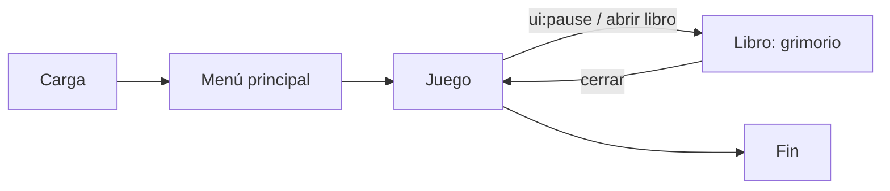

# Guía de UI

Documento del rol **interfaz-ui**. Convención: **[SUPUESTO]** marca lo que propone este rol y no está
decidido en GDD/COMBATE; **[DECISIÓN]** marca lo fijado por el usuario. Estado: parcial (solo el libro-menú). Decisiones del usuario aplicadas: mapeo del libro, viaje por Mapa,
sin táctil, glifos procedurales.

**[DECISIÓN] Armamento «por ahora»:** el jugador lleva **espada + magia**, con **escudo opcional que se equipa**:
dos configuraciones, «solo espada» y «espada + escudo» (las animaciones cambian según la que lleve). Martillo y arco
quedan fuera. Consecuencias en la UI: no hay cambio de arma en partida (se descartan △ pulsar, cruceta ▲ y teclas 1 2 3
de la maqueta; la cruceta ▲ deja de cambiar de arma y pasa a ser el atajo de configuración), ni selector de arma, ni
contador o HUD de flechas. Queda **libre** (reservado) **△ fuera de combate**. Cada configuración tiene su habilidad del
arma en **L1 + R1**: **Estocada de quiebre** (solo espada, EP) y **Embestida** (espada + escudo, EE). El escudo se equipa
desde el libro (Bolso › Armas, §2.8), y **[DECISIÓN] la cruceta ▲ alterna** entre «solo espada» y «espada + escudo», solo
fuera de combate (sin enemigos en alerta); no hay botón de cambio en combate. Detalle en §5.1. El HUD indica la
configuración activa y el nombre de su habilidad.

Reglas base (CLAUDE.md): UI en DOM/CSS sobre el canvas, nunca en WebGL; estilo fantasía realista luminosa,
**nunca cartoon**. La UI escucha eventos del bus y emite acciones; no lee estado interno de los sistemas.

## 1. Mapa de pantallas (parcial)

- **Menú principal (fuera de partida):** PENDIENTE.
- **Pausa / menú en partida = el libro** [DECISIÓN]. No existe un menú de pausa aparte: abrir el menú abre el
  grimorio. Pausa la simulación (`state:changed` → `paused`). `visibilitychange` abre el libro en su última página.
- Algunas acciones del libro (grabar, editar, mutar, crear piedras de paso) solo se permiten en altar/campamento
  (COMBATE 2.13); fuera de ahí la página se muestra en **solo lectura** con el motivo en una línea.

## 2. El libro (menú en partida)

### 2.1 Metáfora y aspecto [SUPUESTO]
Libro grande de cuero y pergamino con doble página abierta (izquierda: lista/índice o ilustración; derecha:
detalle), tinta de runas con brillo cálido tenue. Materiales sobrios y realistas (cuero, papel fibroso, tinta
metálica), sin trazo de cómic. Fondo del juego atenuado y desenfocado con `backdrop-filter` (con alternativa sin
blur si el rendimiento cae). Marcapáginas de tela a un lado como pestañas de apartado. Paleta y tipografía se
toman de `docs/GUIA_VISUAL.md` (tokens como CSS custom properties, `--ui-*`). En pantallas estrechas pasa a
**una sola página** visible.

### 2.2 Apartados (marcapáginas) [SUPUESTO]
| Apartado | Contenido | Sub-pestañas |
|---|---|---|
| **Hechizos** | Una hoja por hechizo; índice con favoritos/archivo; ranuras equipadas (8, con 7 y 8 bloqueables); árbol de mutaciones; propuestas pendientes; importar/exportar código | Grimorio · Ranuras · Mutaciones (incluye propuestas, máx. 5) · Importar |
| **Bolso** | Inventario sin peso del bolso mágico, cuadrícula con filtro y búsqueda; tinta rúnica visible en la cabecera | Armas (espadas y escudos) · Armaduras · Objetos y materiales |
| **Códice** | **Uno solo**, dos secciones: Elemental (runas, elementos y reacciones descubiertas) y Fragmentos (lore, incluidas las hazañas que insinúan al protagonista, GDD 10.4) | Elemental · Fragmentos |
| **Mapa** | Mapa de Valdera con las piedras de paso (posición y orden), nombre, marcador de lugares conocidos | — |
| **Ajustes** | Contenido PENDIENTE (§4) | — |

Orden fijo de izquierda a derecha en la solapa: Hechizos, Bolso, Códice, Mapa, Ajustes. Un apartado sin
contenido aún se muestra con candado y pista, no se oculta (evita que el jugador no sepa que existe).
Los fragmentos nuevos y los hechizos o propuestas sin ver llevan un punto de aviso en su marcapáginas.

### 2.3 Navegación
Dos niveles: **saltar de apartado** y **pasar página** dentro del apartado (hoja de hechizo, página de bolso…).

| Acción | Mando (PS4/PS5) | Teclado | Ratón |
|---|---|---|---|
| Abrir / cerrar libro | OPTIONS / ○ en el nivel raíz | Esc, P (B abre directo en Hechizos) | Botón del HUD |
| Siguiente / anterior **apartado** | R1 / L1 | Tab / Mayús+Tab, o 1–5 directo | Clic en marcapáginas |
| Siguiente / anterior **página** | R2 / L2 (gatillo tratado como botón, con repetición) | E / Q, o Av Pág / Re Pág | Rueda, arrastrar el borde, clic en esquina de la hoja |
| Mover foco en la página | Cruceta o stick izq. | Flechas / WASD | Hover |
| Aceptar / alternar | ✕ | Intro | Clic |
| Equipar (acción secundaria) [DECISIÓN mando] | △ selecciona el hechizo; luego se elige la ranura (cruceta/stick sobre la vista de ranuras) y ✕ confirma; ○ cancela | [SUPUESTO] F activa «equipar» (equivalente a △); luego 1–8 elige ranura (o flechas + Intro); Esc cancela | Arrastrar la hoja a una ranura |
| Vaciar / descartar | □ | Supr | Botón contextual |
| Saltar a índice | L3 | Inicio | Clic en el lomo |
| Atrás | ○ | Esc / Retroceso | Botón «Cerrar» |

**Mapeo [DECISIÓN: aceptado]. Sustituye al de la maqueta**, donde L1/R1 cambiaban de columna y Tab de página. En el
libro final: apartado = R1/L1 y Tab o 1–5; página = R2/L2 y Q/E; ratón con marcapáginas, rueda y arrastre. Las
columnas se recorren con la cruceta. Conflicto resuelto [SUPUESTO]: 1–5 (apartado) y 1–8 (ranura) comparten teclas;
los números eligen ranura solo con el modo «equipar» activo (F, coherente con △ del mando), si no saltan de apartado.
Las ranuras 7 y 8 bloqueadas no son elegibles (`disabled`, motivo «Requiere un arcano descubierto»). Dentro del libro
L2/R2 solo pasan página: los gatillos como modificadores de ranura existen únicamente en combate (§5.1), sin solape
porque el libro pausa la simulación y consume su propio contexto de input. Todo pasa por el
remapeo (§4). Pasar página es una animación de giro de hoja (§3.3). El foco recuerda la última hoja por apartado.
Cada acción se anuncia en una línea de ayuda inferior con los iconos del dispositivo detectado (mando/teclado) y el
control actual remapeado. **Táctil: fuera de alcance** [DECISIÓN]; solo mando y teclado/ratón.

### 2.4 Apartado Hechizos
- **Hoja = un hechizo** [DECISIÓN]. Contenido de la hoja: círculo de runas (iconos y formas, no solo color),
  **nombre rúnico** grande + **subtítulo castellano** debajo, receta (piezas), margen/coste/% de fallo con el
  dominio actual, resonancia (barra hacia 100), rama genealógica corta (padre → hijos), renombrar, favorito,
  archivar, copiar código (`FX1-…`) y tarjeta-imagen.
- **Índice** (página izquierda del apartado): miniaturas del círculo de runas ordenables por favorito, elemento,
  escuela o reciente.
- **Ranuras:** vista con las 8 ranuras (6 + 1 por arcano descubierto, máx. 8, COMBATE M-30), sin páginas; las
  ranuras 7 y 8 se ven con candado hasta desbloquearlas. Equipar: △ (mando) / F (teclado) / arrastrar (ratón), §2.3.
  En el HUD de partida solo el nombre rúnico (§2.7).
- **Mutaciones:** árbol padre → hijos navegable; las 3 variantes ofertadas se presentan como 3 hojas
  «ghost» comparables lado a lado; las propuestas pendientes (máx. 5) aparecen como hojas con la esquina doblada
  y un contador «caduca si llegan 6».
- **Importar:** campo de código (acepta formato laxo, COMBATE 2.13) con mensaje de error claro (checksum,
  versión no soportada); `?receta=` abre aquí directamente.

### 2.5 Estados de una hoja de hechizo [SUPUESTO]
| Estado | Aspecto | Equipable/lanzable |
|---|---|---|
| **Grabado** | Tinta opaca con brillo rúnico, sello en el pie | Sí |
| **Borrador** (sin tinta rúnica) | Trazo a **lápiz gris punteado**, sin brillo; sello «BORRADOR» en diagonal; el círculo de runas aparece como boceto sin animar; botón «Grabar (1 tinta)» deshabilitado si hay 0 tinta, con el contador del bolso al lado | No |
| **Con runas bloqueadas** (importada) | Hoja grabable pero las runas ausentes se dibujan como **silueta** (§2.6); sello «Runas por aprender» | No |
| **Propuesta pendiente** | Esquina doblada, borde de hoja sin encuadernar | Solo tras elegir |
| **Solo lectura** (fuera de altar) | Controles de edición en `disabled` con motivo | Según estado |

Además del color, cada estado lleva **icono + texto** (daltonismo).

### 2.6 Runas no aprendidas [DECISIÓN]
Cada runa que falta se muestra como **silueta** (el glifo en contorno, sin relleno, atenuado) dentro del círculo
y de la lista de piezas, con una **pista de hallazgo** en una línea al enfocarla o con hover (por ejemplo
«Se aprende en santuarios de costa» [SUPUESTO] sin dar coordenadas). Si la pista aún no se conoce, «???» y
una pista genérica por categoría. La receta sigue visible en el libro y es copiable, pero el botón Equipar queda
`disabled` con el motivo («Faltan 2 runas»). Al aprender la runa, la silueta se rellena con una animación breve
(0,6 s, saltable) y la hoja deja de estar bloqueada sin intervención del jugador.

### 2.7 Nombres
- **HUD / ranuras en partida:** solo el **nombre rúnico** (corto, legible).
- **Libro y tooltip:** nombre rúnico + **subtítulo castellano**.
- **Accesibilidad:** el subtítulo castellano se usa como texto accesible (`aria-label` / lector de pantalla) también
  en las ranuras del HUD, aunque el nombre visible sea solo el rúnico.

### 2.8 Apartado Bolso
Cuadrícula sin peso, sin límite de huecos visible. Pestañas Armas (espadas, una equipada a la vez, y **escudos** en una subsección «Mano izquierda» con casilla
«Sin escudo»; [SUPUESTO] el escudo va en Armas por ser de combate y no de armadura; sin flechas ni munición), Armaduras y
Objetos/materiales. La tarjeta de detalle indica la configuración resultante («Solo espada» / «Espada + escudo») y
que cambian las animaciones y la habilidad del arma (**Estocada de quiebre** con solo espada / **Embestida** con espada
+ escudo, L1 + R1). Equipar o quitar el escudo se hace aquí (✕ / Intro / clic sobre el escudo; la casilla «Sin escudo» lo
retira) o con el atajo de §5.1, y no se permite en combate. Sin escudos en el bolso, la subsección muestra «No tienes ningún escudo».
`data-testid`: `bag-shield-<id>`, `bag-no-shield`. Tarjeta de detalle
con descripción y usos (por ejemplo, materiales de crafteo muestran qué recetas los consumen). Contador de **tinta
rúnica** siempre visible en la cabecera del apartado Hechizos y Bolso. Acciones: equipar, favorito, descartar (con
confirmación). Ordenar y filtrar por tipo.

### 2.9 Apartado Códice
Sección Elemental: matriz de reacciones descubiertas (icono + forma + texto). Sección Fragmentos: lista de
entradas de lore ordenadas por zona; las entradas aún no halladas son huecos con título censurado. Solo texto
e ilustración; protagonista mudo, sin diálogo (GDD 10.3).

### 2.10 Apartado Mapa
Mapa de Valdera con las **piedras de paso** (posición y orden): renombrar, reordenar, marcar; crear/borrar solo
donde COMBATE 2.7 lo permita.

**Viaje por Piedra de paso [DECISIÓN]:** el destino se elige en este apartado. Al confirmar, el libro se cierra, se
reproduce la animación del personaje lanzando un **hechizo de portal** y después la transición de 2–3 s con
precarga de celdas ya definida en COMBATE (2.16). Secuencia: confirmar → `ui:travel` {piedraId} → cierre del libro
(fundido 0,2 s) → animación de lanzamiento (≈ 1,5 s) → transición/precarga → llegada. Nombres de evento por acordar
con el arquitecto.

Cómo se ve en el mapa [SUPUESTO]:
| Elemento | Aspecto |
|---|---|
| Piedra disponible | Marcador con círculo rúnico tenue; nombre al enfocar; icono + forma (no solo color) |
| Piedra actual | Marcador relleno con anillo «Estás aquí»; no es destino válido |
| Piedra no descubierta | No aparece (o silueta con «???» si la zona es conocida) |
| Piedra en recarga | Marcador atenuado con reloj de arena y tiempo restante («Recarga: 0:42»); `disabled` con motivo |
| Bloqueada por combate | `disabled` con motivo «Fuera de combate requerido: hay enemigos en alerta» (icono de espadas cruzadas) |
| Coste de maná | En el panel de destino: «Coste: N maná» junto al maná actual; si no alcanza, `disabled` con «Maná insuficiente (faltan X)» |

- **Panel de destino** (página derecha): nombre, distancia aproximada, coste de maná, recarga y botón «Viajar».
  El botón queda `disabled` con el primer motivo aplicable, y al enfocarlo lista todos los motivos. Prioridad:
  combate > maná > recarga.
- **Comprobación al confirmar:** las condiciones se reevalúan en ese instante; si cambian (entra un enemigo en
  alerta) el viaje se cancela con aviso en la línea de ayuda y el libro sigue abierto. «En alerta» llega por el
  bus (la UI no lee estado interno de los sistemas).
- **Pausa:** al confirmar se cierra el libro y la simulación se reanuda para la animación del portal; la
  transición no es cancelable una vez iniciada la precarga.
- **Reducir movimiento:** la animación del hechizo de portal se **acorta** (≈ 0,5 s, sin estela ni destellos,
  solo fundido); la transición conserva la precarga con fundido simple.
- **Controles:** ✕ / Intro para viajar; cruceta/flechas para mover la selección entre piedras.
- **Accesibilidad:** cada piedra es un botón con `aria-label` (nombre, estado, coste); `aria-live` anuncia
  «Viajando a <nombre>» y los motivos de rechazo. `data-testid`: `map-stone-<id>`, `map-travel-btn`,
  `map-travel-reason`.

### 2.11 Glifos de runas [DECISIÓN]
Los glifos son **procedurales**: una gramática de trazos por elemento y por forma, sobre rejilla 3×4, en la línea
de `drawGlyph` en `prototipo/vfx/vfx.js`. El detalle (gramática, trazos por elemento, proporciones) lo fija
director-arte en `docs/GUIA_VISUAL.md`; aquí solo se referencia dónde se usan:
- **Hoja del libro:** círculo de runas y lista de piezas (SVG con `stroke-dashoffset` animable, §3.2).
- **Ranuras del HUD:** versión reducida del glifo junto al nombre rúnico.
- **Runas no aprendidas:** silueta (contorno sin relleno, atenuada, §2.6) del mismo generador.
La UI consume un único generador (runa/receta → path SVG), determinista y sin imágenes. Los glifos acompañan
siempre al nombre o icono de elemento (no depender solo del color).

## 3. Animación de nueva hoja (aprender o grabar un hechizo)

### 3.1 Cuándo ocurre
Al **grabar** una receta (crear o importar), al elegir una **variante de mutación** (se guarda como hechizo
nuevo) y al aprender por mutación una runa que completa una receta bloqueada. Sale de un evento del bus
(p. ej. `spell:learned` / `spell:engraved`, nombres por acordar con el arquitecto) y **no** se muestra en
combate: si ocurre en combate real, se encola y se reproduce al abrir el libro, con un aviso de HUD discreto.

### 3.2 Secuencia [SUPUESTO] (duración total ≈ 3,2 s; «reducida» ≈ 0,8 s)
| t | Fase | Descripción | Audio (para el rol audio) |
|---|---|---|---|
| 0–0,6 s | **Materialización** | El libro se abre en Hechizos; una hoja en blanco se funde sobre el fondo, con fibras de papel y un leve resplandor en el borde | Susurro de papel + inhalación suave grave |
| 0,6–1,8 s | **Tinta rúnica** | Una pluma de luz traza el **círculo y las runas** una a una (trazo animado con `stroke-dashoffset`, orden de la receta); cada runa deja un destello del color del elemento y un tic | Una nota tonal breve por runa (afinada al elemento) sobre un rasgueo continuo de pluma |
| 1,8–2,6 s | **Nombre** | Se escribe el **nombre rúnico** y después el **subtítulo castellano** que aparece en fundido de tinta bajo él | Campanilla suave al cerrar el nombre |
| 2,6–3,2 s | **Sello** | Se estampa el sello de grabado; la hoja queda en su sitio en el índice y recibe foco | Golpe sordo de sello + resonancia corta |

- **Saltable:** cualquier botón de aceptar/atrás o clic salta **al estado final** (hoja completa) sin perder
  ningún dato; el sonido se corta con un fundido de 100 ms. Si lo salta antes de 0,3 s, se pasa directo al final.
- **Borrador:** la animación dibuja el trazo a lápiz, sin tinta ni sello, y termina con el sello «BORRADOR»;
  sin la nota tonal por runa. Al grabar luego el borrador con tinta se reproduce solo la fase 1,8–3,2 s con
  la tinta rellenando el trazo.
- **Reducir movimiento:** sin giro de hoja ni trazo animado: la hoja aparece con fundido corto (≈ 0,3 s), el nombre
  completo a la vez y el sello sin golpe. Los sonidos se mantienen (o ajustables).
- **Subtítulos/texto:** el nombre y el subtítulo se anuncian por región `aria-live="polite"`
  («Hechizo grabado: <rúnico>, <subtítulo>»).
- **Rendimiento:** solo `transform`, `opacity` y trazos SVG (compositor); sin cambios de layout. La animación
  se basa en **tiempo real** (CSS animations/WAAPI, `performance.now()`), no en el paso fijo de la
  simulación (que está en pausa). Máximo una hoja animada a la vez; si llegan varias, se encolan y se agrupan
  en un resumen (« +3 hojas nuevas»).

### 3.3 Pasar página
Giro de hoja de 250–350 ms con `transform: rotateY` y sombra (CSS); con reducir movimiento, cambio instantáneo con
fundido de 100 ms. Pre-renderizar la hoja siguiente fuera de pantalla; no recalcular layout durante el giro.

## 4. Ajustes (apartado del libro)
PENDIENTE. Debe incluir al menos: remapeo de controles (afecta a §2.3), reducir movimiento (§3), efectos de
control suaves (COMBATE 2.15), reducción de parpadeo del círculo inestable y del Velo, volumen, subtítulos.
Persistencia en `localStorage` (try/catch).

## 5. HUD de combate
PENDIENTE en general. Restricción ya fijada: las ranuras de hechizo muestran solo nombre rúnico (con subtítulo como
texto accesible); avisos de inestabilidad en texto/icono (COMBATE 2.15). Fijado abajo: ranuras y controles de combate.

### 5.1 Ranuras de hechizo y controles de combate [DECISIÓN salvo marcado]
Hasta **8 ranuras equipadas, sin páginas** (6 + 1 por arcano descubierto, máx. 8; COMBATE M-30). Se desechan de la
maqueta: paginación L2 + ▲/▼, Tab, indicador 1/2, L2 + ✕ como habilidad del arma y el **cambio de arma** (△ pulsar,
cruceta ▲ como cambio de arma, teclas 1 2 3; la cruceta ▲ se reutiliza como atajo de configuración, abajo). Sin selector de arma en el HUD.

**Indicador de configuración [DECISIÓN del usuario: el HUD lo muestra]:** insignia pequeña junto a las ranuras con icono
de espada sola o espada + escudo y texto corto («Espada» / «Espada + escudo», no solo icono); cambia solo al equipar desde
el libro o con el atajo. Muestra también el nombre de la habilidad del arma (L1 + R1) vigente. `data-testid`:
`hud-loadout` (`data-loadout="sword|sword-shield"`). `aria-label` con el texto completo.

**Atajo de configuración [DECISIÓN]:** mando **cruceta ▲**; teclado [SUPUESTO] **V** (libre: no se usa en libro ni combate;
remapeable, §4); ratón: clic en la insignia `hud-loadout` (`pointer-events` activos solo ahí). Alterna «solo espada» ↔
«espada + escudo». Emite `ui:toggle-loadout`; el sistema responde con el evento de cambio y la UI solo refleja el resultado
(nombre por acordar con el arquitecto).
| Caso | Resultado |
|---|---|
| Éxito (fuera de combate) | La insignia `hud-loadout` se actualiza (destello 0,3 s; sin destello con reducir movimiento) y aviso breve de 1,5 s en la línea de avisos: «Espada + escudo» / «Solo espada», con `aria-live="polite"` |
| En combate (enemigos en alerta) | Rechazo: no cambia nada; la insignia hace un temblor corto (solo opacidad con reducir movimiento) y aviso «No puedes cambiar de equipo en combate» |
| Sin ningún escudo en el bolso | Rechazo con aviso «No tienes ningún escudo» (la insignia sigue en «solo espada»); sugerencia «Consigue uno» sin dar ubicación |
| Escudo equipado pero se pasa a «solo espada» | Siempre permitido fuera de combate; el escudo queda en el bolso |
Los rechazos llevan icono + texto (no solo color) y sonido de «denegado» (rol `audio`). `data-testid`: `hud-loadout-toast`
(`data-kind="ok|combat|no-shield"`). «En alerta» llega por el bus.

**L1 sin stick (guardia neutra) [DECISIÓN]** (en teclado: clic der. sin mover el ratón, ver «Dirección con ratón»): bloquea **todo el daño** con **mucho gasto de aguante**, sin parada perfecta.
Reflejo en el HUD de aguante: mientras L1 está mantenido sin dirección, la barra de aguante muestra un marcador/icono de
«guardia neutra» (escudo con aspa de dirección tachada, texto accesible «Guardia sin dirección: gasta mucho aguante»), y
los golpes bloqueados provocan un descenso visible y rápido de la barra con un destello ámbar al llegar a poco aguante.
`data-testid`: `hud-stamina-neutral-guard`. Los valores exactos los fija COMBATE.

**Revisión de choques de teclas (sin armas):** 1–8 = ranuras de hechizo en combate sin conflicto (las teclas 1 2 3 ya no
cambian arma). En el libro 1–5 saltan de apartado salvo con «equipar» activo (§2.3); no hay solape porque el libro pausa
y usa su propio contexto de input. **Cruceta ▲ = atajo de configuración** (teclado V). **Libres y reservados:** △ fuera de
combate (y ◄ ► ▼ si no se usan para objetos). En combate △ sigue siendo ranura 2/6 con L2/R2 mantenido; sin gatillo no hace nada.

| Control | Mando | Teclado [SUPUESTO] | Ratón [SUPUESTO] |
|---|---|---|---|
| Ranuras 1–4 | Mantener **L2** + □ / △ / ○ / ✕ | 1 / 2 / 3 / 4 | — |
| Ranuras 5–8 | Mantener **R2** + □ / △ / ○ / ✕ | 5 / 6 / 7 / 8 | — |
| Magia elegida | **L2 pulsar y soltar** (sin botón de cara) | Tecla dedicada por definir (propuesta: C) | — |
| Habilidad del arma (según configuración: **Estocada de quiebre** con solo espada / **Embestida** con espada + escudo; COMBATE §1.1) | **L1 + R1 a la vez** | G | Clic izq. + der. a la vez |
| Bloquear / atacar | L1 mantenido / R1 | según mapa base | clic der. / clic izq. |
| Alternar configuración (solo fuera de combate) | **Cruceta ▲** | V [SUPUESTO] | Clic en `hud-loadout` |
| **Dirección de ataque y guardia** [DECISIÓN usuario] | Stick izq. (sin cambios) | **Ratón** (ver abajo); WASD **solo mueve al personaje** | Ratón |

**Dirección con ratón (teclado) [DECISIÓN usuario; mapeo concreto SUPUESTO].** En teclado, la dirección del golpe y de la
guardia (arriba / abajo / izquierda / derecha / neutro) la marca el **ratón**, no WASD. WASD solo desplaza. El mando
conserva el stick izquierdo. Mapeo mínimo:
- **Modo dirección = botón mantenido:** mientras clic der. (guardia) o clic izq. (ataque) están pulsados, el movimiento
  del ratón **no gira la cámara**: alimenta un «stick virtual». Al soltar, la cámara vuelve al ratón. Sin botón pulsado el
  ratón maneja la cámara como siempre (con enemigo fijado, la cámara sigue al objetivo y el ratón queda libre).
- **Stick virtual:** el desplazamiento acumulado se limita a un radio de 60 px y se recentra solo (decae a 0 en 0,6 s sin
  movimiento) [SUPUESTO]. Zona muerta: < 50 % del radio (30 px) = **neutro**, igual que la zona muerta del stick (COMBATE
  §1.1). Eje dominante = dirección; diagonales, por el eje mayor.
- **Referencia:** relativa a la **pantalla/cámara** (arriba = ratón hacia arriba), coherente con la dirección del stick y
  con el chevrón del indicador (§5.2). Al fijar enemigo, la referencia es la misma vista.
- **«Movido justo ahora»** (parada perfecta): el último cambio de dirección cuenta si ocurrió ≤ 150 ms antes del impacto,
  como con el stick. La dirección vigente al pulsar el botón se toma como inicial (retroactiva, como L1 en COMBATE).
- **Guardia sin mover el ratón = guardia neutra** (§5.1: bloquea todo, mucho aguante, sin parada perfecta). Para guardia
  direccional hay que desplazar el ratón con clic der. mantenido.
- **Reflejo en la UI:** con ratón, el HUD muestra un pequeño **indicador de dirección** junto a la mira (cuatro cuñas
  alrededor de un punto; la activa se rellena; neutro = solo el punto), solo mientras hay botón de combate pulsado.
  `data-testid`: `hud-aim-dir` (`data-dir="up|down|left|right|neutral"`). Se alimenta del bus, no del DOM del ratón de la UI.
- **Ajustes:** sensibilidad de dirección (radio 40–100 px) y zona muerta (30–60 %), remapeo de botones y activar/desactivar
  el recentrado; persistidos en `localStorage` (try/catch). **Coordinación:** COMBATE §1.1 («Mapeo teclado y ratón») aún
  lista WASD como dirección y el ratón como alternativa; debe alinearse con esta decisión (lo actualiza `disenador-combate`).
  Para `programador-motor`: el input de ratón emite una dirección discreta + marca de tiempo, igual que el stick.

Alternativa teclado (si 1–8 choca con atajos de objetos): Q/E/R/T = ranuras 1–4 y Mayús + Q/E/R/T = 5–8. No se
elige por defecto porque Mayús suele ser correr/esquivar y Q/E son pasar página en el libro. Todo remapeable (§4).

**Conflicto L2 / R2:** L2 tiene dos usos (pulsar-soltar = magia elegida; mantenido + cara = ranuras 1–4). Se distingue
por si se pulsa un botón de cara mientras está mantenido: al soltar L2 sin botón de cara, se lanza la magia elegida; con
botón de cara, solo se lanza esa ranura y al soltar no se dispara la elegida. R2 ya no es habilidad del arma: queda
libre como modificador de ranuras 5–8, sin solape. R2 pulsar y soltar sin cara: sin acción [SUPUESTO] (no dispara nada).
Con ambos gatillos mantenidos, gana el último pulsado.

**Habilidad del arma (L1 + R1) [SUPUESTO] — nota para programador-motor (input):** L1 mantenido = bloquear y
R1 = atacar, así que la combinación es ambigua. Ventana de simultaneidad ≤ 80 ms entre ambas pulsaciones: la primera
pulsación se **retiene** durante la ventana (no inicia bloqueo ni ataque). Si llega la otra dentro de 80 ms: habilidad del
arma, y se descartan ambas acciones individuales. Si no llega: se ejecuta la acción retenida (bloqueo o ataque) con
80 ms de retraso; el bloqueo retenido se aplica retroactivamente (cuenta desde la primera pulsación para parry).
La ventana debe ser configurable y el retraso es coste de latencia aceptado (≈ 5 frames a 60 Hz). Si L1 ya está
mantenido más de 80 ms, R1 es siempre ataque (no habilidad). Riesgo: contrarresta la respuesta del ataque; probar
en playtest y, si molesta, bajar a 50 ms.

**HUD de las 8 ranuras:** dos grupos de 4, dispuestos en rombo (□ izq., △ arriba, ○ der., ✕ abajo), cada grupo con
su **insignia de gatillo** (L2 el grupo 1–4, R2 el grupo 5–8) y los glifos de cara del dispositivo detectado (teclado:
número). Cada ranura: glifo reducido + nombre rúnico (§2.7), coste de maná y recarga/estado. Al mantener un gatillo, su
grupo se resalta y el otro se atenúa. Ranuras 7 y 8 sin desbloquear: silueta con candado y «Arcano», no seleccionables y
sin glifo de cara activo; no ocultarlas, para que el jugador sepa que existen. Ranura vacía: contorno punteado.
Estado no solo por color: icono + texto (sin maná, recarga, inestable). `data-testid`: `hud-slot-1`…`hud-slot-8`,
`hud-slot-group-l2`, `hud-slot-group-r2`.

### 5.2 Indicador de dirección del ataque enemigo (COMBATE §1.1) [SUPUESTO en medidas]
Solo golpes cuerpo a cuerpo (los hechizos y proyectiles enemigos no tienen dirección). La UI lo recibe por el bus
(p. ej. `enemy:attack-telegraph` {enemigoId, dir, imparable, tVentana}; nombre por acordar con el arquitecto) y no lee
estado de IA.
- **Forma:** chevrón (flecha) en el lado por el que **entra** el golpe, apuntando hacia el centro del enemigo fijado:
  izquierda, derecha, arriba (golpe que baja) o abajo (golpe que sube). Dirección distinguible por **posición y por forma**,
  no solo por color: arriba = chevrón ancho con trazo vertical; abajo = chevrón con base; laterales = chevrón simple.
  Estilo sobrio de tinta/metal luminoso (sin cómic), color neutro cálido (`--ui-warn`, contraste AA sobre la escena).
- **Posición:** anclado alrededor del enemigo fijado a ~0,9 m de su centro proyectado a pantalla, con margen de seguridad
  de 24 px a los bordes; si el enemigo está fuera de cuadro, se pega al **borde de pantalla** del lado del enemigo, con
  el chevrón orientado según la dirección del golpe. Con varios enemigos atacando: solo el más inminente (máx. 2).
- **Tamaño:** chevrón de 48 px (alto) en 1080p, escala con `clamp(36px, 4.5vh, 64px)`. Modo «ampliado»: ×1,5 con trazo
  más grueso (6 px) y contorno de 2 px de color oscuro.
- **Fases:** aparece con la anticipación (opacidad 0,6, sin parpadeo) y **destella** al abrirse la ventana de parada
  (200 ms antes del impacto): escala 1,0 → 1,25 → 1,0 y brillo máximo durante 120 ms, luego se apaga con el impacto.
- **Imparable (rojo):** color `--ui-danger` (rojo), forma distinta (chevrón doble con rombo/aspa central), no destella
  como ventana de parada sino que pulsa lentamente; texto accesible «Imparable: esquiva». No depender del rojo solo.
- **Sonido (rol `audio`):** silbido con paneo estéreo al lado de entrada y «tic» metálico al abrirse la ventana; sonido
  propio para imparable. Es independiente de la opción visual: sigue activo si el indicador se oculta.
- **Accesibilidad (Ajustes):** «Indicador de ataque»: Normal / Ampliado (×1,5) / Alto contraste (blanco con contorno
  negro; el imparable mantiene su forma doble y añade texto «¡Imparable!»). Reducir movimiento: sin escala en el destello,
  solo cambio de brillo/opacidad (150 ms). Región `aria-live="assertive"` opcional («Golpe desde la izquierda») activable.
  Persistido en `localStorage` (try/catch). La «guardia asistida» de COMBATE §1.1 se activa en el mismo apartado.
- **Dirección propia (guardia):** el chevrón enemigo indica el lado por el que entra el golpe; para pararlo el jugador
  orienta la guardia hacia ese lado con el **stick izq. (mando)** o el **ratón con clic der. mantenido (teclado)**, §5.1.
  Con ratón, `hud-aim-dir` se muestra junto a la mira y su cuña activa debe coincidir con el chevrón; no se usa WASD.
- **Rendimiento:** un único elemento DOM reutilizado, movido con `transform` y `opacity`; se actualiza solo en cambios de
  fase, con `pointer-events: none`.
- `data-testid`: `hud-attack-indicator` (con `data-dir="left|right|up|down"`, `data-phase="windup|window"`,
  `data-unstoppable="true|false"`), `hud-attack-indicator-edge` (variante pegada al borde),
  `settings-attack-indicator-mode` (Normal/Ampliado/Alto contraste).

## 6. Accesibilidad general
PENDIENTE. Requisitos ya fijados que debe heredar: nombres accesibles (§2.7), no depender solo del color (§2.5),
reducir movimiento (§3.2), foco visible y contraste AA.

## 7. Pantalla de carga
PENDIENTE.

## 8. Fin de partida
PENDIENTE.

## 9. Tokens de diseño, estados y responsive
PENDIENTE (hover/focus/disabled genéricos, escala tipográfica, breakpoints). Para el libro: una página bajo
~900 px de ancho (ventanas pequeñas de escritorio). Sin requisitos táctiles (fuera de alcance);
objetivos clicables cómodos para ratón (≥ 32 px).

## 10. Preguntas abiertas
1. **[RESUELTA]** **Mapeo de mando:** ¿se acepta cambiar L1/R1 (columna → apartado) respecto a la maqueta, y L2/R2 para pasar
   página? Choca con que L2/R2 son gatillos analógicos; basta con tratarlos como botón.
2. **[RESUELTA]** **Mapa → viaje:** ¿se viaja a una piedra de paso desde el libro (con transición 1–3 s, COMBATE 2.16) o solo
   usando el objeto/lugar físico?
3. **Escala del grimorio:** es ilimitado; ¿límite de rendimiento del índice (virtualización) y vista tipo
   mosaico además de hojas?
4. **Eventos del bus:** nombres definitivos (`spell:engraved`, `spell:learned`, `rune:learned`, `ui:open-book`).
   Lo decide el arquitecto en `docs/ARQUITECTURA.md`.
5. **Tinta rúnica:** ¿dónde se consigue y se muestra cuando falta? Falta fuente en GDD (hoy solo existe en 2.13).
6. **Grabar en combate:** confirmar que la grabación y la animación quedan restringidas a altar/campamento.
7. **Subtítulo en el HUD:** ¿opción para mostrarlo bajo el nombre rúnico en las ranuras (texto grande)?
8. **Fragmentos de lore:** ¿el Códice se llena por exploración o por objetos del bolso? Afecta a la progresión.
9. **[RESUELTA]** **Táctil:** el GDD/maqueta contemplan táctil; ¿es objetivo del producto final? Condiciona §2.3 y la anchura.
10. **[RESUELTA]** **Idioma de las runas:** ¿se muestran con glifos propios (arte) o alfabeto ya existente? Afecta a las
    siluetas (§2.6) y a los iconos por elemento (director-arte).

Resoluciones: (1) aceptado el mapeo de §2.3; (2) viaje desde el Mapa del libro, ver §2.10; (9) táctil no es
objetivo, solo mando y teclado/ratón; (10) glifos procedurales, ver §2.11 (detalle en GUIA_VISUAL.md).
